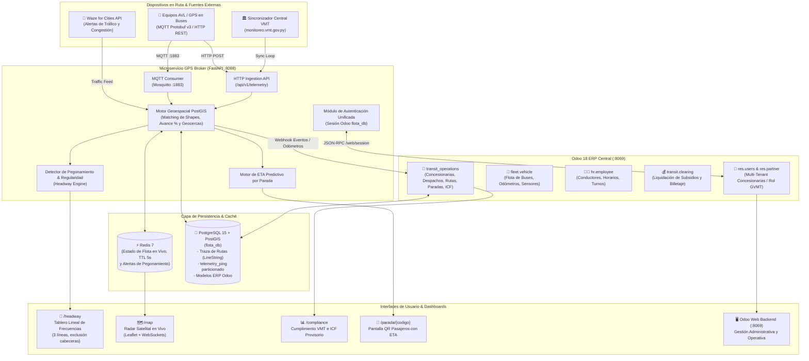
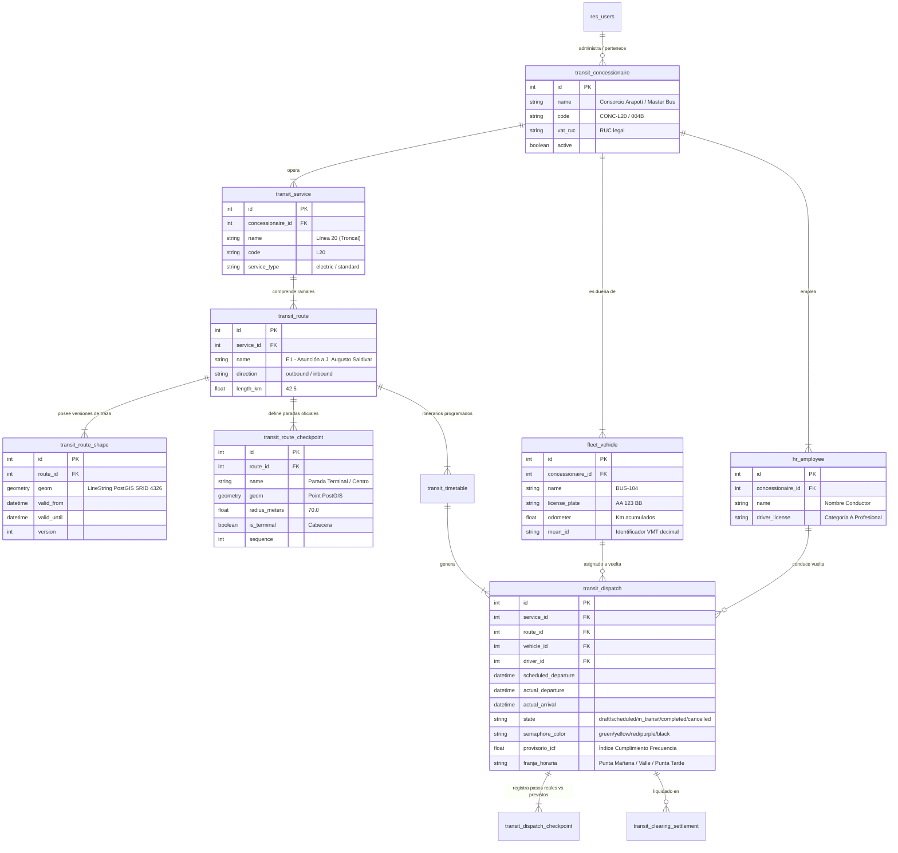
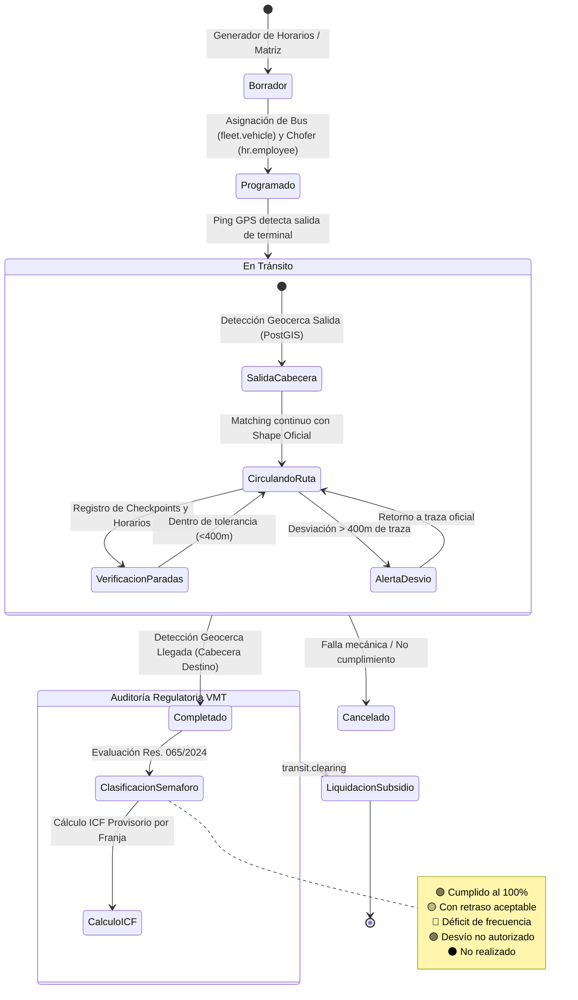

# 🚌 Arquitectura Integral del ERP de Transporte (Poliverso Transit & Odoo 18)

Este documento detalla la arquitectura completa del sistema de gestión de transporte público, combinando el **ERP Odoo 18**, el **Microservicio de Telemetría GPS (FastAPI/PostGIS/Redis)**, los flujos de datos de **hardware/AVL** y el modelo de control regulatorio (**Resolución GVMT N° 065/2024 & Decreto N° 710/2023**).

---

## 1. Diagrama de Arquitectura General del Sistema



---

## 2. Modelo de Datos Relacional del ERP (`transit_operations`)

El siguiente diagrama entidad-relación describe cómo interactúan las tablas operativas con los modelos nativos de Odoo (`fleet`, `hr`, `res_users`):



---

## 3. Flujo de Autenticación de Sesión Unificada (Multi-Tenant)

El microservicio GPS en el puerto `:8088` comparte la misma sesión que Odoo en el puerto `:8069` mediante cookies conformes a **RFC 6265**:

```mermaid
sequenceDiagram
    autonumber
    actor Usuario as Operador / Regulador
    participant Browser as Navegador Web
    participant Broker as GPS Broker (:8088)
    participant Odoo as Odoo ERP (:8069)
    participant DB as PostgreSQL (flota_db)

    Usuario->>Browser: Accede a http://187.77.247.23:8088/headway
    Browser->>Broker: GET /headway (sin cookie)
    Broker-->>Browser: HTTP 303 Redirect -> /login?redirect=/headway
    Browser->>Usuario: Muestra pantalla de Login Unificado

    Usuario->>Browser: Ingresa usuario (admin) y contraseña
    Browser->>Broker: POST /login (credentials)
    Broker->>Odoo: JSON-RPC /web/session/authenticate (flota_db, admin, pass)
    Odoo-->>Broker: OK {uid: 2, name: "Administrator", session_id: "token_123"}

    Broker->>DB: Consulta roles y empresa de usuario (res_users -> transit_concessionaire)
    DB-->>Broker: Rol: Administrador Global / Todas las Empresas
    Broker-->>Browser: HTTP 303 Redirect -> /headway<br/>Set-Cookie: session_id=token_123; Path=/; HttpOnly; SameSite=lax

    Browser->>Broker: GET /headway (Cookie: session_id=token_123)
    Broker->>Broker: Valida session_id (Caché rápida 45s / Odoo get_session_info)
    Broker-->>Browser: HTTP 200 OK (Renderiza Tablero Lineal con badge "Administrator")

    opt Navegación a Odoo ERP
        Usuario->>Browser: Clic en botón "⚡ Odoo ERP" (:8069)
        Browser->>Odoo: GET http://187.77.247.23:8069/web (Cookie: session_id=token_123)
        Note over Odoo: Odoo detecta la MISMA cookie enviada por el navegador
        Odoo-->>Browser: Ingreso directo al backend sin pedir login
    end
```

---

## 4. Ciclo de Vida Operativo de un Despacho (`transit.dispatch`)



---

## 5. Resumen de Capas y Tecnologías

| Capa | Componente | Función Principal |
|---|---|---|
| **ERP Transaccional** | **Odoo 18 (`flota_db`)** | Gestión de flota, RRHH de choferes, planificación horaria, multi-tenant de concesionarias y liquidación financiera. |
| **Ingesta & Telemetría** | **FastAPI + Mosquitto MQTT** | Recepción de pings de buses a alta frecuencia (cada 3-5 seg) sin sobrecargar el ERP. |
| **Motor Geoespacial** | **PostGIS 15** | Shapes LineString, geocercas circulares, cálculo de `% de avance`, desvíos y vinculación bitemporal. |
| **Caché en Tiempo Real** | **Redis 7** | Estado de flota en memoria viva, latencia sub-milisegundo y detección de pegonamiento (*Bunching*). |
| **Regulación VMT** | **Motor de Reglas Res. 065** | Cálculo automatizado de franjas horarias (Puntas/Valle) y semáforo de cumplimiento para subsidios. |
